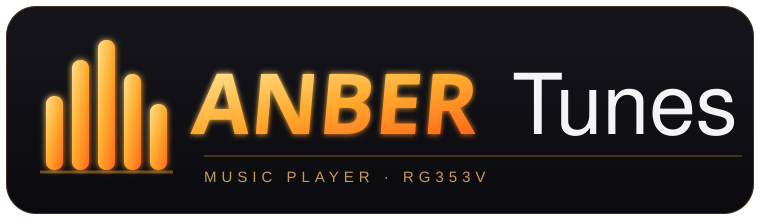

  

<b>A music player for the Anbernic RG353V, with your library, covers, lyrics and a pickable amber look.</b>

  <a href="https://github.com/retrotiv/AnberNext">AnberNext</a> ·
  <a href="https://github.com/ujjwal313/boombrick">Based on Boombrick</a> ·
  <a href="../../releases">Releases</a>

  

---

## What this is

AnberTunes is a music player for the **Anbernic RG353V**, part of the
[AnberNext](https://github.com/retrotiv/AnberNext) project. It plays the music on your card,
shows album art and synced lyrics, and can download from YouTube Music for offline listening.

It is a fork of **[Boombrick](https://github.com/ujjwal313/boombrick)** by **ujjwal313**. The
app, and all the hard work behind it, is theirs. AnberTunes adds a few things on top for the
RG353V and the AnberNext look.

## What AnberTunes adds

- A warmer **amber** brand look.
- A pickable **interface colour**: follow the album art (as before) or fix a palette colour
  (amber, rose, magenta, purple, blue, teal, green), applied live in **Settings → Interface colour**.
- Spotify tracks that Spotify refuses to play (its newer DRM, the `audio key code 1`) are now
  **skipped as unavailable** instead of freezing on a misleading "throttle" message.

## Features (from Boombrick)

- Your music: MP3, FLAC, Opus and M4A from the card, gapless, with ReplayGain levelling.
- Browse by album, artist, song or genre; a queue with shuffle and repeat, kept between launches.
- Covers from the files or the Cover Art Archive, and synced lyrics (files, .lrc or LRCLIB).
- YouTube Music: search, browse and download songs as tagged Opus files with covers and lyrics.
- Keeps playing in the background while you play a game.
- Sleep timer, screen-off playback, and more. See the [Boombrick README](https://github.com/ujjwal313/boombrick) for the full list.

## Install

AnberTunes ships with **[AnberNext](https://github.com/retrotiv/AnberNext)**: on a device
running AnberNext, open **Tools → AnberNext Update** over Wi-Fi and it installs. It lives in
`Tools/rg353/AnberTunes.pak`.

A couple of honest notes:
- The **YouTube Music download** needs the in-app **Downloader** (yt-dlp) updated once over Wi-Fi
  before it can fetch anything.
- **Spotify streaming** depends on Spotify. They are locking down the old playback method, so some
  or all tracks may be unplayable; AnberTunes skips those. Your local music always plays.

## Credits and licence

AnberTunes is free software under the **GNU General Public License v3**, the same as Boombrick.
Full credit for the player goes to **ujjwal313** and the Boombrick contributors, and to the
NextUI and MinUI community it builds on. See `LICENSE` and `NOTICE`.

Upstream: https://github.com/ujjwal313/boombrick
